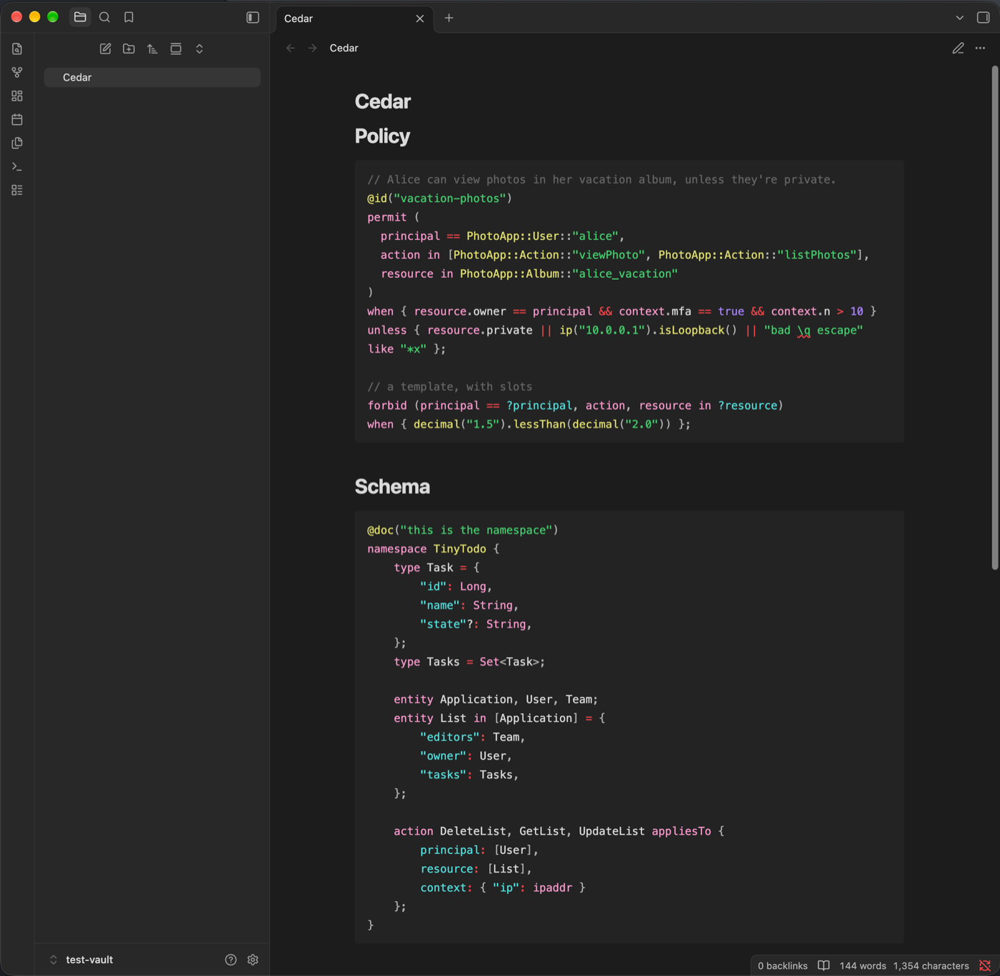

<!-- Generated from https://thefellow.github.io/projects/obsidian-cedar/ by scripts/generate_llm_content.py; do not edit. -->

# Obsidian Cedar plugin

Source: [https://thefellow.github.io/projects/obsidian-cedar/](https://thefellow.github.io/projects/obsidian-cedar/)

## Pyramid summary

- **~2 words:** Obsidian Cedar
- **~8 words:** Cedar code block highlighting in Obsidian using upstream grammars.
- **Expanded:** Cedar policy and schema highlighting for Obsidian notes, using the official VS Code extension's grammars.

## Full content

[View the repository](https://github.com/TheFellow/obsidian-cedar)
[Install from Obsidian](https://community.obsidian.md/plugins/cedar)

The Obsidian Cedar plugin highlights `cedar` policy and `cedarschema` fenced code blocks in Obsidian notes, in Live Preview, Source mode, and Reading view. Colours come from the active theme, and a `cedar-<kind>` class on every token lets a CSS snippet restyle any part of the language.

<figure class="article-figure">
  
  <figcaption>A Cedar policy and the TinyTodo schema highlighted in Reading view.</figcaption>
</figure>

The highlighting comes from the TextMate grammars in the official [Cedar extension for VS Code](https://github.com/cedar-policy/vscode-cedar), bundled unmodified and run by a pure-JavaScript TextMate engine. One tokenizer feeds both of Obsidian's highlighters: a CodeMirror stream mode for the editor and a Prism hook for Reading view, embeds, hover previews, and PDF export.

### Why it is worth exploring

- It reuses the same grammars as VS Code and [jetbrains-cedar](/projects/jetbrains-cedar.md), so Cedar is tokenized identically in all three editors.
- It adapts a line-at-a-time TextMate tokenizer to two very different highlighting APIs without writing a second grammar.
- Its scope-to-colour mapping mirrors jetbrains-cedar's, so the plugins stay consistent as the grammars change.

The [build note](/notes/cedar-highlighting-in-obsidian.md) walks through the design. In the repository, start with the README, then `src/editor-mode.ts` and `src/reading-view.ts` for the two adapters.
